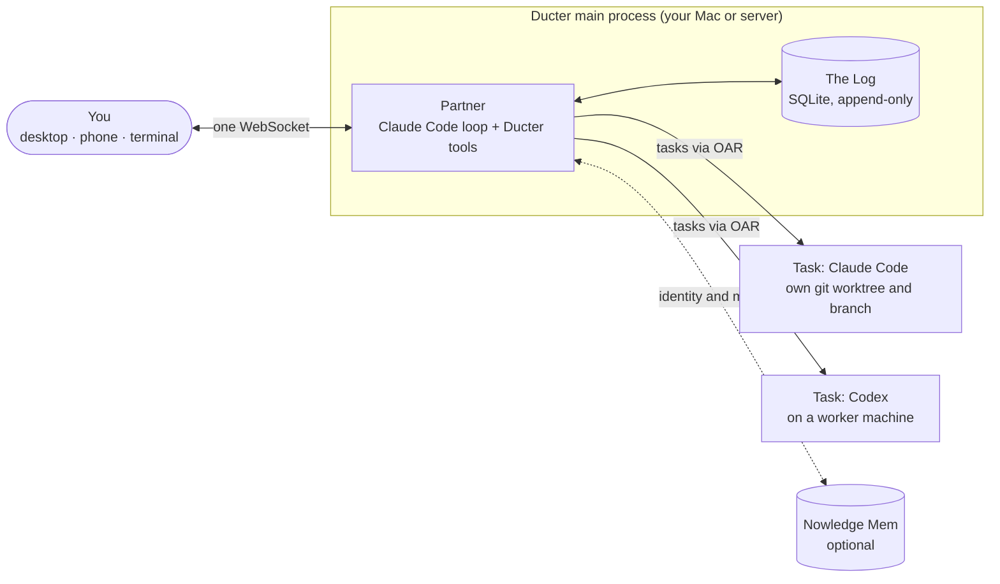

# Ducter

Ducter is a personal AI you run yourself. You talk to one partner; it hands the real work to
Claude Code or Codex on your own machines, using the AI plans you already pay for, and comes
back when the work is done, with proof.

It asks for your attention only when a decision is truly yours, and every task stays open for
you to look into and steer whenever you want.

<p>
  
  
</p>
<p>
  
  
</p>

> **Status: early preview.** Ducter works end to end on macOS and on a Linux server, but expect
> rough edges and breaking changes. The desktop app is macOS only.

## What it feels like

- **One conversation.** You write the way you'd write to a colleague: "Fix the flaky test in
  ~/dev/foo, then tell me." Quick questions get a quick answer; bigger work becomes a task.
- **Silence means it's going fine.** Tasks run in the background. You hear back when one is
  done, or when it needs a decision from you.
- **Decisions come with a default.** "Rebase before merging? Default: rebase, in 29 min." Press
  Go, Hold, or reply in your own words, or let the default happen.
- **Results come with proof.** A finished task says what it changed and how it checked (tests,
  CI runs, the diff), then offers Merge, a draft PR, or a look at the changes.
- **Open anything, any time.** *On hand* shows every task at a glance. Open one to read its
  transcript, see its diff, and talk to it directly.
- **Your machines, your plans.** Tasks run on your Mac or on a server you own, each in its own
  git worktree and branch, on the Claude Code or Codex login you already have. Merging is
  always your call.
- **It remembers you.** With [Nowledge Mem](https://mem.nowledge.co), your partner starts with
  the identity and context you already keep there, shared with the other AIs you use.
- **English and 中文** throughout, following your system language.

## Quickstart

You need at least one of [Claude Code](https://docs.anthropic.com/en/docs/claude-code) or
[Codex](https://github.com/openai/codex) installed and signed in.

### The Mac app

Build it once (needs [Bun](https://bun.sh) and [Go](https://go.dev)):

```sh
git clone https://github.com/wey-gu/ducter && cd ducter
scripts/make-app.sh        # dist/Ducter.app and a .dmg
```

Open `Ducter.app`. It checks your Mac, shows the one thing to fix if anything blocks, and opens
the conversation. Ducter keeps working when you close the window; **Stop Ducter** in the menu
stops it. Built without an Apple Developer ID, the app is signed ad hoc, so the first open
goes through **System Settings → Privacy & Security → Open Anyway**
([details](design/build-and-run.md)).

### The command line

```sh
scripts/install.sh      # builds `ducter` (and the desktop app if Go is present) into ~/.local/bin
ducter doctor           # checks this Mac; every missing item comes with the command that fixes it
ducter up               # starts your partner and opens the desktop app
```

`ducter status` shows tasks and open decisions from a terminal. From a checkout you can also
skip the install: `bun install && bun packages/cli/src/main.ts up`.

### On a server

Keep your partner awake while your Mac sleeps: build the Linux binary on your Mac, install it
as a systemd user service on the server, and pair the Mac app or your phone with a one-time
code.

```sh
scripts/install.sh --linux ducter-linux    # on your Mac, then copy the folder for your server's CPU
sh ducter/install.sh --service             # on the server
```

The server listens on `127.0.0.1` only; reach it through your own domain (a one-line Caddy
setup) or an SSH tunnel. Other machines can join as workers, and tasks can run on them. The
full walkthrough is in [`design/build-and-run.md`](design/build-and-run.md).

## How it works



- **One partner.** It runs on Claude Code as its loop, with Ducter's own tools and persona.
- **Tasks run on real harnesses.** Each task is a Claude Code or Codex session started through
  [OAR](https://github.com/botiverse/oar), in its own git worktree on a `ducter/<slug>` branch.
  Tasks report back with a summary, evidence, and questions that carry a default.
- **The Log is the truth.** Your messages, replies, task events, reports and decisions are
  appended to one local SQLite log. The conversation, *On hand* and every task view are read
  from it, so nothing is lost when a harness session ends.
- **Clients.** The desktop app is a native UI built with [MyGo](https://github.com/egoist/mygo);
  the phone client is a small web app served by the main process. Both speak the same
  protocol.

The ideas behind the design are in [`design/principles.md`](design/principles.md) and the
mechanics in [`design/`](design/); start at [`docs/README.md`](design/README.md). Why
Ducter exists is in [`motivation.md`](motivation.md), and what comes next is in
[`design/roadmap.md`](design/roadmap.md).

## Contributing

Ducter is young and opinionated, and its design is written down before its code. Read
[CONTRIBUTING.md](CONTRIBUTING.md) to get started, and report security issues as described in
[SECURITY.md](SECURITY.md).

## 中文

Ducter 是一个自己部署的个人 AI。你只跟一个伙伴说话，它把真正的活儿交给你自己机器上的
Claude Code 或 Codex 去做，用的是你已经在付费的 AI 订阅，做完了带着证据回来告诉你。只有真正需要你拍板的事才会打扰你，而每件事你随时都能点开、查看、接手。

目前是早期预览版：macOS 桌面端和 Linux 服务器都能用，界面中英双语。上手方法见上面的
Quickstart，设计思路见 [`design/principles.md`](design/principles.md)。

## License

[Apache License 2.0](LICENSE).
