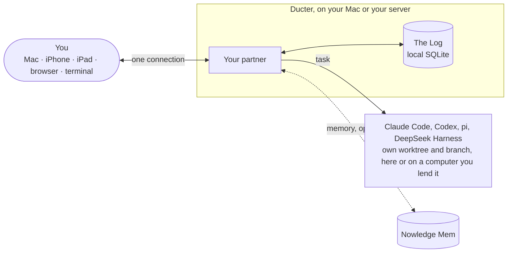

<h1 align="center">Ducter</h1>

<p align="center">
  <b>Say it once. Hear back when it's done.</b><br>
  An open-source personal AI on your own Mac or server. You talk to one partner; it runs the
  work on Claude Code, Codex, pi or DeepSeek Harness with the plans you already pay for, and
  speaks up only when something is done or needs you.
</p>

<p align="center">
  <a href="https://github.com/wey-gu/ducter/actions/workflows/ci.yml"></a>
  <a href="LICENSE"></a>
</p>

<p align="center">
  <a href="https://ducter.ai">ducter.ai</a> ·
  <a href="docs/getting-started.md">Getting started</a> ·
  <a href="docs/README.md">Docs</a> ·
  <a href="#中文">中文</a>
</p>

<p align="center">
  
</p>

## Why Ducter

- **One partner, not a wall of sessions.** You write *"Fix the flaky compaction test in HawDB
  and tell me when it's done."* Your partner starts the task, watches it, and comes back with
  the result, its proof and **Merge into main**. You can open any task and steer it yourself.
- **Your agents, your subscriptions.** Tasks run on Claude Code, Codex, pi or DeepSeek Harness,
  signed in as you, with your own skills and settings. No Ducter account, no API key to start.
- **Your computers.** It lives on your Mac, or on a Linux server you own, at home or in the
  cloud, so it keeps working while your laptop sleeps. Lend it more computers to run tasks on.
- **Quiet until it matters.** Done comes with proof, a question comes with a default it will
  take if you don't answer, and on a quiet day you hear nothing.
- **Open source and self-hosted.** Hosted agent workbenches come and go, and the best personal
  AIs are closed. Ducter is Apache 2.0 and runs where you put it, so nobody can wind it down
  for you ([why it exists](motivation.md)).
- **Ready the first time.** One line installs it; it sets up what's missing and greets you with
  things to start from your own folders and accounts.

## Where you use it

| | |
|---|---|
| **Mac** | The desktop app, Apple silicon. Ducter can live here and run tasks here. |
| **Linux server** | x64 or arm64, at home or in the cloud. Runs as a service and stays on. |
| **iPhone and iPad** | One app, in public beta on [TestFlight](https://testflight.apple.com/join/Z4GvWt7t). On a wide iPad, On hand stands beside the conversation. |
| **Android** | In your phone's browser today, answering Go or Hold from the notification. The Android app is coming soon. |
| **Terminal** | The `ducter` command, on the Mac or the server. |

A phone needs an address it can reach from anywhere, which today means Ducter on a server with
your own domain ([Your phone](docs/phone.md)).

## Get Ducter

You need [Claude Code](https://docs.anthropic.com/en/docs/claude-code) or
[Codex](https://github.com/openai/codex) signed in with your own account; if neither is there,
the Mac app installs one and walks you through signing in.

**On a Mac** (Apple silicon), paste this into Terminal. It installs the signed app and the
`ducter` command, and opens it:

```sh
curl -fsSL https://ducter.ai/install.sh | sh
```

Or download the `.dmg` from the [latest release](https://github.com/wey-gu/ducter/releases/latest).

**On a server**, run it as a service, then give it your domain (HTTPS, and a code for your Mac
and phone):

```sh
curl -fsSL https://ducter.ai/install.sh | sh -s -- --service
ducter domain ducter.example.com
```

**On iPhone or iPad**, [join the TestFlight beta](https://testflight.apple.com/join/Z4GvWt7t) and
connect with the address and code from `ducter pair`.

**With your AI agent:** ask it to *"Install the ducter-deploy skill from
github.com/wey-gu/ducter/tree/main/skills and deploy Ducter on my server."*
([For AI agents](docs/for-agents.md))

Building from source, the walkthroughs and every command: [Install](docs/install.md) and
[Getting started](docs/getting-started.md).

## What it looks like

<table>
  <tr>
    <td width="50%"></td>
    <td width="50%"></td>
  </tr>
  <tr>
    <td><b>On hand.</b> Every task, what's waiting for you, and your routines.</td>
    <td><b>An opened task.</b> The outcome first, then what it did and its changes.</td>
  </tr>
  <tr>
    <!-- devices.webp predates the 0.0.8 device cards; retake it from the app, don't redraw it. -->
    <td></td>
    <td></td>
  </tr>
  <tr>
    <td><b>Your devices.</b> The computers Ducter works on, and what each one can do.</td>
    <td><b>Partner.</b> What it thinks with, and who does the tasks.</td>
  </tr>
</table>

## What you can hand it

- **Coding work.** Each task gets its own git worktree and `ducter/…` branch; merging is your call.
- **Reviews and write-ups.** "Review this week's open PRs." "Write the v0.4 release notes."
- **Things that take time.** Wait for a CI run, keep trying until the tests pass, or run every
  Monday at 9 ([Waiting and routines](docs/waiting-and-routines.md)).
- **The web.** It reads pages in its own Chrome window; logins, forms and payments stay with you.
- **Your mail and calendar.** Say yes once, and it tells you only what needs you: a morning
  message with at most three things ([Accounts it can read](docs/accounts.md)).
- **What you already decided.** With [Nowledge Mem](https://mem.nowledge.co) (optional), your
  partner and its tasks share one memory with your other AI tools.

> **Early preview.** Expect rough edges and breaking changes. See the
> [changelog](CHANGELOG.md).

## Under the hood

For people who already run several agents at once, what makes them hold up as one partner:

- **One adapter for four agents**, through [OAR](https://github.com/botiverse/oar): clean
  sessions that still carry your own skills and settings, and a partner that can only read and
  decide on every one of them (enforced, not asked).
- **Small windows on purpose.** About 200K tokens per session; a long conversation stays coherent
  through digests and recall ([memory](design/memory.md), [context](design/context.md)).
- **One registry of facts per agent** ([`harness-facts.ts`](packages/protocol/src/harness-facts.ts),
  [readable twin](design/harnesses.md)): windows, compaction points and verified versions, which
  `ducter doctor` checks against what you have installed.
- **Budgets are tests.** Prompt and tool-list sizes fail the build when they grow, and a partner
  change carries a fresh eval result.



## Privacy and safety

Nothing lands without you: Ducter never merges, never works in your own checkout, never types
your passwords and never pays. Your work reaches an AI provider only through your own agent's
login or key. A server listens on itself only, and each phone or computer connects with a
one-time code. Details: [Privacy and safety](docs/privacy-and-safety.md).

## Docs and contributing

- **Using Ducter:** [the docs](docs/README.md), starting with [Getting started](docs/getting-started.md).
- **Building Ducter:** [why it exists](motivation.md), the [principles](design/principles.md),
  the [design notes](design/README.md), [build and run](design/build-and-run.md) and the
  [roadmap](design/roadmap.md). Ducter writes its design down before its code;
  [CONTRIBUTING.md](CONTRIBUTING.md) explains how, and [SECURITY.md](SECURITY.md) how to report
  a security issue.

Ducter is made by the people behind Nowledge Mem. Once a pull request of yours is merged, mention
it and we'll send you a free lifetime Nowledge Mem license ([details](CONTRIBUTING.md)).

## 中文

Ducter 是开源、自己部署的个人 AI。你只跟一个伙伴说话，它把活儿交给 Claude Code、Codex、pi 或
DeepSeek Harness 去做，用的是你本来就在付的订阅。它住在你的 Mac 上，或者你自己的 Linux 服务器上（家里或云上都行）；做完了一两句话告诉你结果，证据点开就能看，只有真要你拍板的事才来找你，而且先替你想好默认的做法。

在哪儿用：Mac 桌面 app（Apple 芯片）、Linux 服务器、iPhone 和 iPad（同一个 app，TestFlight 公测，iPad 横屏时对话和手头的事并排）；Android 现在用手机浏览器，Android app 即将推出。界面中英双语。上手请看
[Getting started](docs/getting-started.md)。

## License

[Apache License 2.0](LICENSE)
