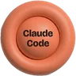
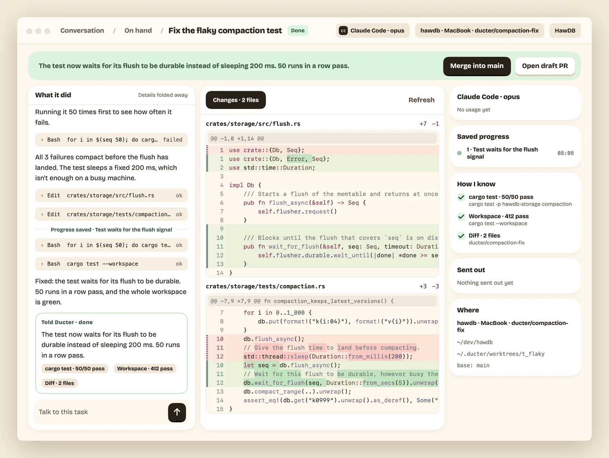
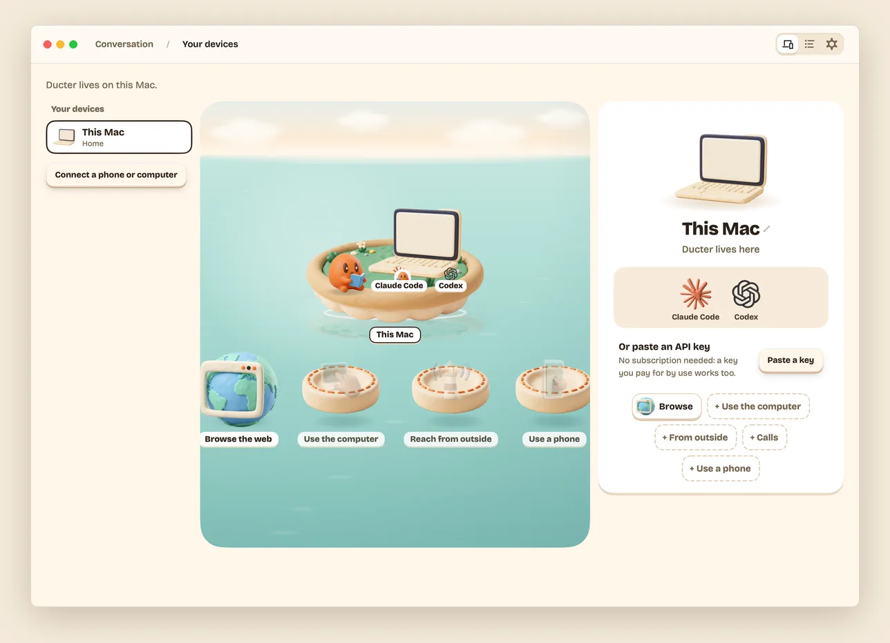
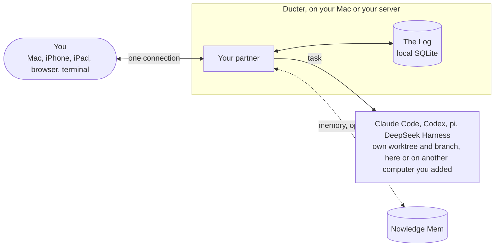

<h1 align="center">Ducter</h1>

<p align="center">
  <b>Hand it ten things. Hear back only what needs you.</b>
</p>

<p align="center">
  A personal AI for builders, on your own computers or servers.<br>
  You talk to one partner. It hands the work to the AI agents you already pay for,<br>
  like Claude Code or Codex, and brings it back with how it was checked.<br>
  Free and open source.
</p>

<p align="center">
  <a href="https://github.com/wey-gu/ducter/actions/workflows/ci.yml"></a>
  <a href="LICENSE"></a>
</p>

<p align="center">
  <a href="https://ducter.ai">ducter.ai</a>&emsp;
  <a href="https://ducter.ai/start">Get started</a>&emsp;
  <a href="https://ducter.ai/download">Download</a>&emsp;
  <a href="https://ducter.ai/docs">Docs</a>
</p>

<p align="center">
  
</p>

> **Early preview.** Everything below runs today on a Mac and on a Linux server; the iPhone app is
> in public beta. Expect rough edges and breaking changes. See the [changelog](CHANGELOG.md).

**Install on a Mac** (Apple silicon) with one line, or see [every way to get it](#get-ducter):

```sh
curl -fsSL https://ducter.ai/install.sh | sh
```

## How it goes

| | |
|---|---|
| **1. You say it** | *"Fix the flaky compaction test in HawDB, and tell me when it's done."* Then three more things. |
| **2. It hands it off** | Each becomes a task on Claude Code or Codex, signed in as you, on its own branch, on your Mac or your server. While they work, you hear nothing. |
| **3. You decide** | *"Fixed: 50 of 50 runs pass, and so do the 412 workspace tests."* You read how it knows, and tap **Merge into main**. Nothing lands without you. |

Any task is yours to open: every step, its changes and its browser. Steer it in your own words, or
hand it to another AI agent mid-way. A task can also wait for a CI run, keep going until the tests
pass, or come back every Monday at 9 ([Waiting and routines](docs/waiting-and-routines.md)).

## What it can reach

Only what you turn on. Anything that sends, pays, calls or can't be taken back waits for your Go.

<table>
  <tr>
    <td width="50%"><b>Your computers and servers.</b> It lives on your Mac or a Linux server you own; add more computers with one line (<a href="docs/add-a-computer.md">Add a computer</a>).</td>
    <td width="50%"><b>The AI agents you have.</b> Claude Code, Codex, pi and DeepSeek Harness, signed in as you. Antigravity too, when you ask for it by name.</td>
  </tr>
  <tr>
    <td><b>A real browser.</b> Its own Chrome window. Watch it from your phone and take a turn when a page needs you (<a href="docs/devices.md#browsing-the-web">Browsing the web</a>).</td>
    <td><b>Your Mac's apps.</b> It exports the Keynote deck or answers the mail in your Mac's own apps, with Stop in reach (<a href="docs/devices.md#tasks-in-your-macs-apps">Use the computer</a>).</td>
  </tr>
  <tr>
    <td><b>A phone of its own, or yours.</b> An Android phone that runs on your Mac, or your own Android phone, borrowed for a while (<a href="docs/devices.md#ducters-phone">Use a phone</a>).</td>
    <td><b>Phone calls.</b> It rings a restaurant, a clinic or a shop for you, only after you tap Call (<a href="docs/calls.md">Phone calls</a>).</td>
  </tr>
  <tr>
    <td><b>Your mail and calendar.</b> Say yes once; each morning, at most three things that need you (<a href="docs/accounts.md">Accounts it can read</a>).</td>
    <td><b>Your chat apps.</b> The same conversation in iMessage, WeChat, Telegram or Slack (<a href="docs/chat-apps.md">Chat apps</a>).</td>
  </tr>
  <tr>
    <td><b>One memory, and your other agents.</b> With <a href="https://mem.nowledge.co">Nowledge Mem</a>, one memory across your AI tools, and the agents you open yourself can hand it work.</td>
    <td><b>Small apps, from one sentence.</b> A trip expense tracker or a habit tracker, on every device, changed by asking (<a href="docs/apps.md">Your own small apps</a>).</td>
  </tr>
  <tr>
    <td><b>Errands, to the checkout.</b> It books and buys with your saved sign-ins and cards, filled in without being seen; paying is your own tap (<a href="docs/buying-and-booking.md">Buying and booking</a>).</td>
    <td><b>Share from your phone.</b> A page, a photo or a PDF, from any app's Share. On iPhone and Android (<a href="docs/pictures.md#share-from-another-app">Share</a>).</td>
  </tr>
</table>

## Ducter is for you if

- You run several Claude Code or Codex sessions and lose track of which one is waiting on you.
- You want the work to carry on while your laptop sleeps, on a computer you own.
- You already pay for an AI plan, and want no second bill and no new account.
- You'd rather answer from your phone, or from the chat app you already use.
- You'd like the same partner to watch your mail and calendar, and flag the one thing that can't wait.
- You want to read every line of the software that holds your keys and your mail.

| Before | With Ducter |
|---|---|
| Ten terminal tabs, and no idea which one is waiting on you. | One conversation. **On hand** shows every task, and what needs you comes to the top with what it would do. |
| Your laptop closes, and the agent stops. | Ducter can live on a server you own, and keeps working while your Mac sleeps. |
| A question sits unanswered while you're away. | Every question comes with the answer it would take. **Go** is one tap, from your phone. |
| You explain your project again in every session. | Your partner remembers, and you can see what it knows. |
| "Done", with nothing to show for it. | Finished work comes with **How I know**: the tests that ran, the checks, the changes. |
| The one mail that matters hides in your inbox. | It reads the pile for you, and brings up that one with a next step. |

## Get Ducter

You need [Claude Code](https://docs.anthropic.com/en/docs/claude-code) or
[Codex](https://github.com/openai/codex) signed in with your own account; if you have neither,
the Mac app installs one and walks you through signing in.

**On a Mac** (Apple silicon), paste this into Terminal. It installs the signed app and the
`ducter` command, and opens it:

```sh
curl -fsSL https://ducter.ai/install.sh | sh
```

Or download the `.dmg` from the [latest release](https://github.com/wey-gu/ducter/releases/latest).

**On a server**, run it as a service, then choose how your Mac and phone reach it. Either one
sets up HTTPS and gives you a code:

```sh
curl -fsSL https://ducter.ai/install.sh | sh -s -- --service
ducter tailscale                   # private: only your devices in your Tailscale network, no open ports
ducter domain ducter.example.com   # or your own domain, with an A record to the server
```

With Tailscale, turn on MagicDNS and HTTPS Certificates in its admin console once, and keep the
Tailscale app on your phone and Mac. [Install](docs/install.md#a-linux-server-that-stays-on) has
the steps.

**On iPhone or iPad**, [join the TestFlight beta](https://testflight.apple.com/join/Z4GvWt7t) and
connect with the address and code from `ducter pair`.

**With your AI agent:** paste *"Set up Ducter on this Mac for me. Follow the guide at
https://ducter.ai/skills/ducter-deploy/SKILL.md"* into Claude Code or Codex (or "on my server",
for a server). [Get started](https://ducter.ai/start) walks you through either path
([For AI agents](docs/for-agents.md))

Building from source, the walkthroughs and every command: [Install](docs/install.md) and
[Getting started](docs/getting-started.md).

## Where you use it

| | |
|---|---|
| **Mac** | The desktop app, for a Mac with Apple silicon (M1 or later). Ducter can live here and run tasks here. |
| **Linux server** | x64 or arm64, at home or in the cloud. Runs as a service and stays on. |
| **iPhone and iPad** | One app, in public beta on [TestFlight](https://testflight.apple.com/join/Z4GvWt7t). On a wide iPad, On hand stands beside the conversation. |
| **Android** | The Ducter app, from each [GitHub release](https://github.com/wey-gu/ducter/releases/latest); it updates itself, and a foldable opened like a book shows the conversation and On hand on either side of the fold. Or your phone's browser. |
| **Terminal** | The `ducter` command, on the Mac or the server. |

Away from home, a phone reaches Ducter in one of three ways: over your Tailscale network, at a
server's own domain, or at a Mac at home set up **From outside** with your domain on Cloudflare
([Your phone](docs/phone.md)).

## What it looks like

<table>
  <tr>
    <td width="50%"></td>
    <td width="50%"></td>
  </tr>
  <tr>
    <td><b>On hand.</b> Every task, what's waiting for you, and your routines.</td>
    <td><b>An opened task.</b> The outcome first, then what it did and its changes.</td>
  </tr>
  <tr>
    <!-- devices.webp predates the 0.0.8 device cards; retake it from the app, don't redraw it. -->
    <td></td>
    <td></td>
  </tr>
  <tr>
    <td><b>Your devices.</b> The computers Ducter works on, and what each one can do.</td>
    <td><b>Partner.</b> What it thinks with, and who does the tasks.</td>
  </tr>
</table>

## Why open source

Hosted agent workbenches come and go, and the best personal AIs are closed. Ducter is Apache 2.0
and runs where you put it, so nobody can wind it down for you ([why it exists](motivation.md)).

## Under the hood

For people who already run several agents at once, what makes them hold up as one partner:

- **One adapter for four agents**, through [OAR](https://github.com/botiverse/oar): clean
  sessions that still carry your own skills and settings, and a partner that can only read and
  decide on every one of them (enforced, not asked).
- **Small windows on purpose.** About 200K tokens per session; a long conversation stays coherent
  through digests and recall ([memory](design/memory.md), [context](design/context.md)).
- **One registry of facts per agent** ([`harness-facts.ts`](packages/protocol/src/harness-facts.ts),
  [readable twin](design/harnesses.md)): windows, compaction points and verified versions, which
  `ducter doctor` checks against what you have installed.
- **Budgets are tests.** Prompt and tool-list sizes fail the build when they grow, and a partner
  change carries a fresh eval result. Updates are rehearsed end to end on a Linux VM before a
  release.
- **Each agent's own browser first.** Ducter's own Chrome is the fallback, on your Mac or your
  server. In a Mac's apps, Ducter's own app tools check every click before it happens.



## Privacy and safety

Nothing lands without you: Ducter never merges, never works in your own checkout, never sees
your passwords, and never pays, sends or calls without your OK. In your Mac's apps it never opens
a password manager, a bank or System Settings. Your work reaches an AI provider only through your own agent's
login or key. A server listens on itself only, and each phone or computer connects with a
one-time code. Details: [Privacy and safety](docs/privacy-and-safety.md).

## Docs and contributing

- **Using Ducter:** [the docs](docs/README.md), starting with [Getting started](docs/getting-started.md).
- **Building Ducter:** [why it exists](motivation.md), the [principles](design/principles.md),
  the [design notes](design/README.md), [build and run](design/build-and-run.md) and the
  [roadmap](design/roadmap.md). Ducter writes its design down before its code;
  [CONTRIBUTING.md](CONTRIBUTING.md) explains how, and [SECURITY.md](SECURITY.md) how to report
  a security issue.

Ducter is made by the people behind Nowledge Mem. Once a pull request of yours is merged, mention
it and we'll send you a free lifetime Nowledge Mem license ([details](CONTRIBUTING.md)).

## License

[Apache License 2.0](LICENSE)
