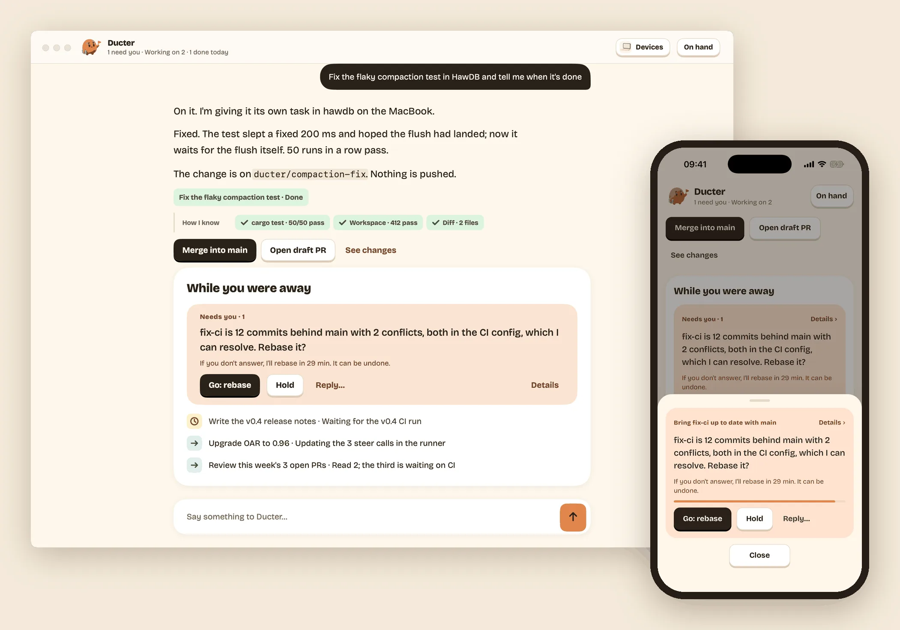
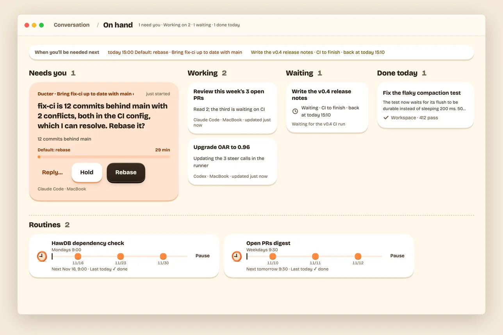
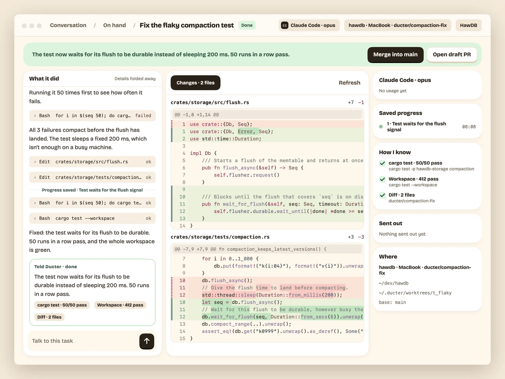
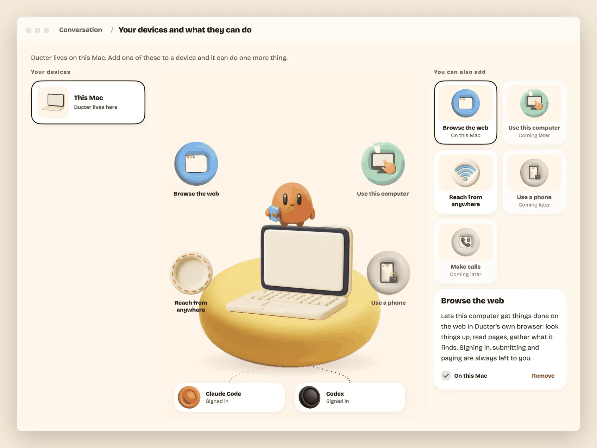
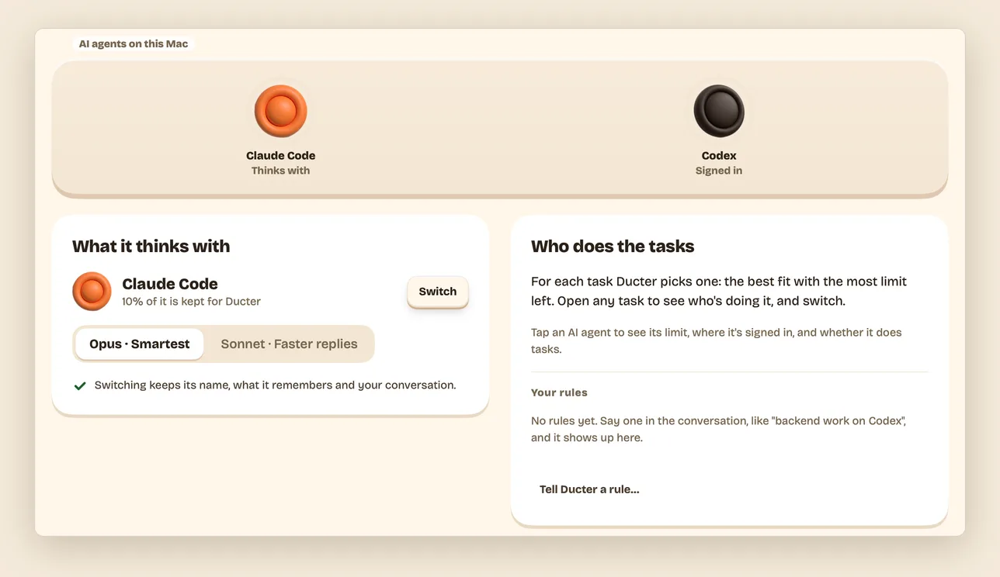
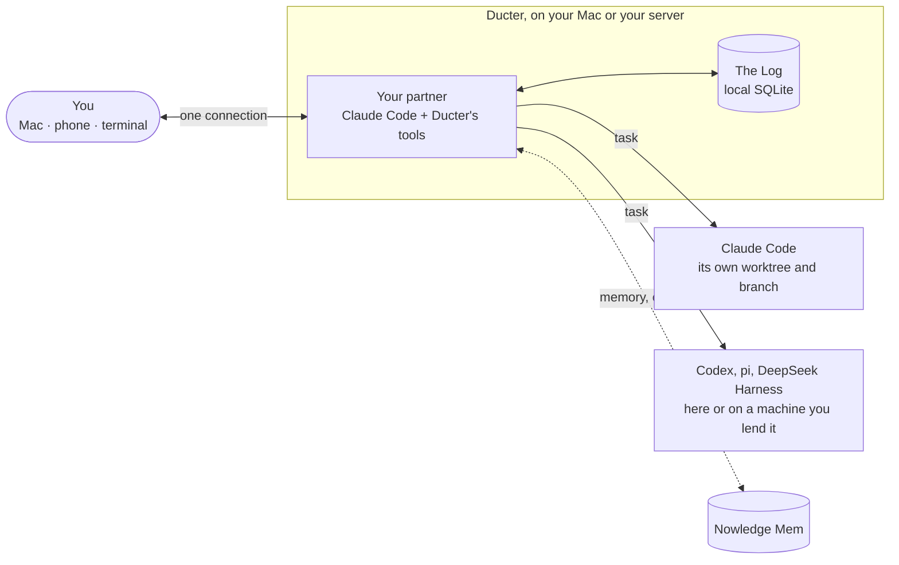

<h1 align="center">Ducter</h1>

<p align="center">
  <b>Say it once. Hear back when it's done.</b><br>
  Ducter is a personal AI that runs on your own Mac or server. You tell one partner what you
  want; it hands the work to the AI agents you already use, on the plans you already pay for,
  and comes back when the work is done or a decision is yours to make.
</p>

<p align="center">
  <a href="https://github.com/wey-gu/ducter/actions/workflows/ci.yml"></a>
  <a href="LICENSE"></a>
</p>

<p align="center">
  <a href="https://ducter.ai">ducter.ai</a> ·
  <a href="docs/getting-started.md">Getting started</a> ·
  <a href="docs/README.md">Docs</a> ·
  <a href="#中文">中文</a>
</p>

<p align="center">
  
</p>

## What it feels like

You write to Ducter the way you'd write to a colleague: *"Fix the flaky compaction test in
HawDB and tell me when it's done."* It says it's on it, and then it's quiet. The work happens
in the background, on your Mac or a server you own, in a separate copy of your project.

When it's done, it tells you what it did in a line or two, with **Merge into main** right
there and the proof one tap away (the tests it ran, the diff). When it needs you, it asks one
plain question with a default, *"Rebase it? If you don't answer, I'll rebase in 29 min,"* and
you take it, hold it, or reply in your own words, on the Mac or on your phone.

Silence means it's going fine. Everything it's doing is one click away whenever you want to
look.

## What you can do today

- **Hand off coding work.** "Fix the failing tests in my-app." "Upgrade OAR to 0.96 and fix
  what breaks." Each task gets its own git worktree and `ducter/…` branch; merging is your
  call.
- **Ask for reviews and write-ups.** "Review this week's open PRs." "Write the v0.4 release
  notes once CI is green."
- **Leave it things that take time.** "Tell me when #1592's CI passes." "Keep fixing until the
  tests are green." "Every Monday at 9, check HawDB's dependencies." It waits, keeps trying, or
  runs on a schedule, and all of it shows on **On hand**.
- **Look things up on the web.** On a Mac, Ducter reads pages in its own Chrome window, separate
  from yours. Logins, forms and payments stay with you.
- **Answer from your phone.** Decisions arrive with the default already chosen, and your nights
  stay quiet.
- **Keep it working while your Mac sleeps.** Run Ducter on a Linux server, and lend it other
  machines to work on.
- **Use the AI agents you already have.** Ducter works with Claude Code, Codex, pi and DeepSeek
  Harness today, on your own logins, settings and skills. Your partner thinks with Claude Code
  and picks which agent does each task; you can switch it for any task. English and 中文
  throughout.

<table>
  <tr>
    <td width="50%"></td>
    <td width="50%"></td>
  </tr>
  <tr>
    <td><b>On hand.</b> Every task at a glance, what is waiting for you, and your routines.</td>
    <td><b>An opened task.</b> The outcome first, then what it did and its changes.</td>
  </tr>
  <tr>
    <td></td>
    <td></td>
  </tr>
  <tr>
    <td><b>Your devices.</b> The computers Ducter works on, and what each one can do.</td>
    <td><b>Partner.</b> What it thinks with, and who does the tasks.</td>
  </tr>
</table>

> **Early preview.** Ducter works end to end on a Mac and on a Linux server. Expect rough edges
> and breaking changes. The desktop app is macOS (Apple silicon) only;
> the phone version runs in your phone's browser, and an iPhone app is coming.

## It doesn't start from zero

Much of what your partner needs to know is somewhere else: in your mail, your calendar, and
last week's sessions with your other AI tools. Some of that it can use today. The rest is on
the way, and none of it needs your passwords.

- **One memory for all your AIs (works today).** [Nowledge Mem](https://mem.nowledge.co) keeps
  what you've decided and what you're working on, from every AI tool you connect to it. Your
  partner reads from it and adds to it, and you see *Noted* when it does. Without Mem, it
  remembers your conversation.
- **Your accounts, through your OpenConnector (coming soon).** Gmail, Google Calendar and
  other services will connect through [OpenConnector](https://github.com/oomol-lab/open-connector):
  OOMOL's hosted one, or your own on your own machine. Ducter holds its key, and the AI agents
  never see your passwords or tokens. Reading your inbox is fine; anything that would send waits
  for your Go.
- **Your AI agents, reaching each other (early, coming soon).** With Nowledge Bridge, the
  Claude Code session in your terminal can hand your partner a job, and your partner can ask
  that session what it knows. It checks with you before it takes the job or sends the question.

## Get Ducter

You need [Claude Code](https://docs.anthropic.com/en/docs/claude-code) or
[Codex](https://github.com/openai/codex), signed in with your own account
([which AI agents](docs/faq.md#which-ai-agents-does-it-work-with)). If neither is on your Mac
yet, the app installs one and walks you through signing in.

### Download the Mac app

Signed and notarized builds will be on
[GitHub Releases](https://github.com/wey-gu/ducter/releases). The first release is on its way;
until then, build the app from source (below).

Open the `.dmg`, drag **Ducter** to **Applications**, and open it. It checks your Mac, sets up
what's missing without a Terminal, and opens the conversation. Closing the window doesn't stop
it; **Stop Ducter** in the menu does. [Getting started](docs/getting-started.md) walks you
through the first five minutes.

### Build from source

With [Bun](https://bun.sh) and [Go](https://go.dev) installed:

```sh
git clone https://github.com/wey-gu/ducter && cd ducter
scripts/make-app.sh        # dist/Ducter.app and a .dmg
```

Without a Developer ID the app is signed ad hoc, so macOS needs one extra step the first time
([what to do](docs/troubleshooting.md#ducter-not-opened)). If you'd rather use a terminal,
`scripts/install.sh` puts the `ducter` command in `~/.local/bin`; `ducter doctor` checks your
Mac and `ducter up` starts your partner.

### On a server

Keep your partner awake while your Mac sleeps. Ducter runs as a systemd user service and listens
on `127.0.0.1` only; you reach it through your own domain or an SSH tunnel, and your phone and
Mac connect with a one-time code.

```sh
scripts/install.sh --linux ducter-linux    # on your Mac; copy the folder for your server's CPU
sh ducter/install.sh --service             # on the server
```

The walkthrough is in [Install](docs/install.md#a-linux-server-that-stays-on).

## How it works



- **One partner talks with you.** It runs on Claude Code with Ducter's own tools, answers
  quick things itself, and turns bigger work into tasks.
- **Tasks run on real AI agents.** Each is a session of Claude Code, Codex, pi or DeepSeek
  Harness started through [OAR](https://github.com/botiverse/oar), in its own worktree. It
  reports back with a summary, how it checked, and questions that carry a default.
- **One local log holds everything.** The conversation, On hand and every task view are read
  from it, so nothing is lost when a session ends or a window closes.
- **Clients are thin.** The Mac app is native ([MyGo](https://github.com/egoist/mygo), no
  webview); the phone client is a small web app. Both speak the same protocol.

## Privacy and safety

- **Nothing lands without you.** Ducter never merges, never works in your own checkout, and never
  types your passwords. Every result says what was sent out.
- **Your machines, your accounts.** There is no Ducter cloud and no Ducter account. Your work
  reaches an AI provider only through your own AI agent's login or key.
- **Only your devices get in.** A server listens on itself only; a phone or another computer
  connects with a one-time code, and you can disconnect it at any time.

The details are in [Privacy and safety](docs/privacy-and-safety.md).

## Docs

- **Using Ducter:** [Getting started](docs/getting-started.md) · [Install](docs/install.md) ·
  [Waiting, keep going, routines](docs/waiting-and-routines.md) ·
  [Your partner and settings](docs/settings.md) · [Your devices](docs/devices.md) ·
  [Your phone](docs/phone.md) ·
  [Privacy and safety](docs/privacy-and-safety.md) · [FAQ](docs/faq.md) ·
  [Troubleshooting](docs/troubleshooting.md)
- **Building Ducter:** [why it exists](motivation.md), the
  [principles](design/principles.md), the [design notes](design/README.md), every command in
  [build and run](design/build-and-run.md), and the [roadmap](design/roadmap.md).

## Contributing

Ducter writes its design down before its code. [CONTRIBUTING.md](CONTRIBUTING.md) explains how a
change is made and what is wanted now. Report security issues as described in
[SECURITY.md](SECURITY.md).

## 中文

Ducter 是跑在你自己 Mac 或服务器上的个人 AI。你只跟一个伙伴说话，它把活儿交给你已经在用的
AI agent（Claude Code、Codex、pi、DeepSeek Harness），用的是你本来就在付的订阅。做完了，它一两句话告诉你结果，证据点开就能看；只有真要你拍板的事才来找你，而且先替你想好默认的做法。等消息、反复试到成功、每周例行的事，都在「手头的事」里一眼看清。

现在是早期预览版：Mac（Apple 芯片）和 Linux 服务器都能用，手机上可以看进展、做决定，界面中英双语。上手请看
[Getting started](docs/getting-started.md)。

## License

[Apache License 2.0](LICENSE)
