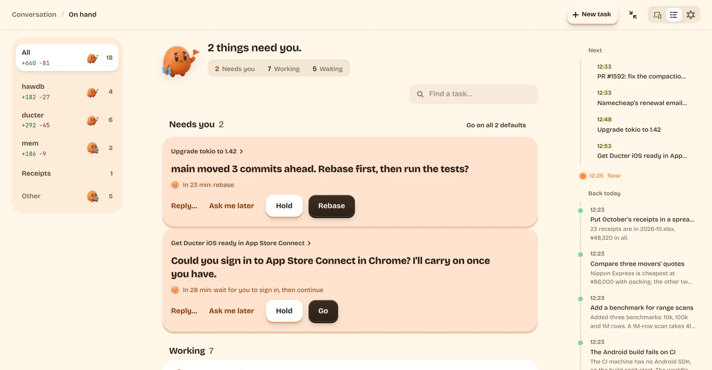

<h1 align="center">Ducter</h1>

<p align="center">
  <b>Hand it ten things. Hear back only what needs you.</b>
</p>

<p align="center">
  A personal AI for builders, on your own computers or servers.<br>
  You talk to one partner. It hands the work to the AI agents you already pay for,<br>
  like Claude Code or Codex, and brings it back with how it was checked.<br>
  Free and open source.
</p>

<p align="center">
  <a href="https://github.com/wey-gu/ducter/actions/workflows/ci.yml"></a>
  <a href="LICENSE"></a>
</p>

<p align="center">
  <a href="https://ducter.ai">ducter.ai</a>&emsp;
  <a href="https://ducter.ai/start">Get started</a>&emsp;
  <a href="https://ducter.ai/download">Download</a>&emsp;
  <a href="https://ducter.ai/docs">Docs</a>
</p>

<p align="center">
  <picture>
    <source media="(prefers-color-scheme: dark)" srcset="apps/site/public/shots/many-dark.webp">
    
  </picture>
</p>

> **Early preview.** Everything below runs today on a Mac and on a Linux server; the iPhone app is
> in public beta. Expect rough edges and breaking changes. See the [changelog](CHANGELOG.md).

**Try it on a Mac** (Apple silicon) with one line, or see [every way to get it](#install):

```sh
curl -fsSL https://ducter.ai/install.sh | sh
```

That installs the signed Mac app, puts `ducter` in `~/.local/bin`, and opens it. On a Linux
server, add `-s -- --service`: it installs the `ducter` bundle for the server's processor and
keeps it running.

## Why it's different

- **One partner, not a wall of sessions.** You talk to one named partner, in one conversation,
  from your phone, your desk or the chat app you already use. It keeps the thread and remembers
  what you told it; the tasks stay behind it.
- **It uses the agents you already pay for.** Claude Code, Codex, pi, DeepSeek Harness and others
  do the work under their own sign-in, on the plans and keys you already have. Ducter adds the
  partner, the task board and the memory around them; it doesn't sell you another model.
- **It runs where you do.** Your Mac, a Linux server you own, a phone. There is no account to
  sign up for and no hosted workspace holding your code. Every task is yours to open; a coding
  task works in its own copy on its own branch, and nothing merges, pays, sends or calls without
  your **Go**.

## Install

**On a Mac** (Apple silicon, M1 or later). This installs the signed app, puts the `ducter`
command in `~/.local/bin`, and opens the app:

```sh
curl -fsSL https://ducter.ai/install.sh | sh
```

Or download the `.dmg` from the [latest release](https://github.com/wey-gu/ducter/releases/latest).
It is signed and notarized by Apple.

**On a Linux server** that stays on, run it as a service, then give your Mac and phone a way in.
Either of these sets up HTTPS and gives you a one-time code:

```sh
curl -fsSL https://ducter.ai/install.sh | sh -s -- --service
ducter tailscale                   # private: only your devices in your Tailscale network, no open ports
ducter domain ducter.example.com   # or your own domain, with an A record to the server
```

With Tailscale, turn on MagicDNS and HTTPS Certificates in its admin console once. The
[Install](docs/install.md#a-linux-server-that-stays-on) page has the full walkthrough.

**On iPhone or iPad**, [join the TestFlight beta](https://testflight.apple.com/join/Z4GvWt7t)
and connect with the address and code from `ducter pair`.

**On Android**, download the Ducter app from each
[GitHub release](https://github.com/wey-gu/ducter/releases/latest); it keeps itself up to date.
Any phone's browser works too.

**With your AI agent:** paste *"Set up Ducter on this Mac for me. Follow the guide at
https://ducter.ai/skills/ducter-deploy/SKILL.md"* into Claude Code or Codex (or "on my server",
for a server). [Get started](https://ducter.ai/start) walks through either path
([For AI agents](docs/for-agents.md)).

Building from source, every command and every walkthrough: [Install](docs/install.md) and
[Getting started](docs/getting-started.md).

## What runs where

| | |
|---|---|
| **Mac** | The desktop app, for a Mac with Apple silicon (M1 or later). Ducter can live here and run tasks here. |
| **Linux server** | An Intel, AMD or ARM processor, at home or in the cloud. Runs as a service and stays on. |
| **iPhone and iPad** | One app, in public beta on [TestFlight](https://testflight.apple.com/join/Z4GvWt7t). On a wide iPad, On hand stands beside the conversation. |
| **Android** | The Ducter app, from each [GitHub release](https://github.com/wey-gu/ducter/releases/latest); it updates itself. Or your phone's browser. |
| **Terminal** | The `ducter` command, on the Mac or the server. |

Away from home, a phone reaches Ducter in one of three ways: over your Tailscale network, at a
server's own domain, or at a Mac at home set up **From outside** with your domain on Cloudflare
([Your phone](docs/phone.md)). Ducter keeps working when you close the window; your Mac can sleep
while a server carries on ([Your devices](docs/devices.md)).

## The agents it drives

You need at least one of these installed and signed in on the computer that does the work. Ducter
never proxies a login: each agent runs on your own account, plan or key.

- **Can be your partner:** Claude Code, Codex, pi, DeepSeek Harness.
- **Take any task, but never the partner:** Devin CLI, Cursor, Dim.
- **Only when you ask for them by name:** Antigravity, Kimi Code CLI, OpenCode.

[Which AI agents does it work with?](docs/faq.md#which-ai-agents-does-it-work-with) has the
details, including which ones work while you are away and which need you there.

## What it can reach

Only what you turn on. Anything that sends, pays, calls or can't be taken back waits for your
**Go**.

- **Your computers and servers.** Add another computer with one line, and tasks run there
  ([Add a computer](docs/add-a-computer.md)).
- **A real browser, and your Mac's apps.** Its own Chrome window, or the apps on your Mac, with
  **Stop** in reach ([Browsing the web](docs/devices.md#browsing-the-web),
  [Use the computer](docs/devices.md#tasks-in-your-macs-apps)).
- **A phone of its own, or yours.** An Android phone that runs on your Mac, or your own Android
  phone borrowed for a while ([Use a phone](docs/devices.md#ducters-phone)).
- **Mail, calendar and the chat apps you already use.** The same conversation in iMessage,
  WeChat, Telegram, Slack or Feishu / Lark, and a morning note with only what needs you
  ([Accounts](docs/accounts.md), [Chat apps](docs/chat-apps.md)).
- **Errands to the checkout, and phone calls.** It books and buys with your saved sign-ins and
  cards; paying is your own tap. It rings a restaurant, a clinic or a shop only after you say
  **Call** ([Buying and booking](docs/buying-and-booking.md), [Phone calls](docs/calls.md)).
- **One memory, and small apps you ask for.** With [Nowledge Mem](https://mem.nowledge.co), one
  memory across your AI tools; a trip expense tracker or a habit tracker, on every device
  ([Memory](docs/privacy-and-safety.md#memory-with-nowledge-mem), [Your own small apps](docs/apps.md)).

## How it goes

| | |
|---|---|
| **1. You say it** | *"Fix the flaky compaction test, and tell me when it's done."* Then three more things. |
| **2. It hands it off** | Each becomes a task on Claude Code, Codex or another agent you chose, signed in as you, on its own branch, on your Mac or your server. While they work, you hear nothing. |
| **3. You decide** | *"Fixed: 50 of 50 runs pass, and so do the 412 workspace tests."* You read how it knows, and tap **Merge into main**. Nothing lands without you. |

Any task is yours to open: every step, its changes and its browser. Steer it in your own words, or
hand it to another AI agent mid-way. A task can also wait for a CI run, keep going until the tests
pass, or come back every Monday at 9 ([Waiting and routines](docs/waiting-and-routines.md)).

## Ducter is for you if

- You run several Claude Code or Codex sessions and lose track of which one is waiting on you.
- You want the work to carry on while your laptop sleeps, on a computer you own.
- You already pay for an AI plan, and want no second bill and no new account.
- You'd rather answer from your phone, or from the chat app you already use.
- You'd like the same partner to watch your mail and calendar, and flag the one thing that can't wait.
- You want to read every line of the software that holds your keys and your mail.

| Before | With Ducter |
|---|---|
| Ten terminal tabs, and no idea which one is waiting on you. | One conversation. **On hand** shows every task, and what needs you comes to the top with what it would do. |
| Your laptop closes, and the agent stops. | Ducter can live on a server you own, and keeps working while your Mac sleeps. |
| A question sits unanswered while you're away. | Every question comes with the answer it would take. **Go** is one tap, from your phone. |
| You explain your project again in every session. | Your partner remembers, and you can see what it knows. |
| "Done", with nothing to show for it. | Finished work comes with **How I know**: the tests that ran, the checks, the changes. |
| The one mail that matters hides in your inbox. | It reads the pile for you, and brings up that one with a next step. |

## Under the hood

- **One home.** Your conversation, tasks and settings live in `~/.ducter` on the computer you
  choose; if you connect Nowledge Mem, your memory lives there too. Your Mac, phone and chat apps
  are views on the same conversation.
- **One task, one copy.** A coding task works in its own copy of the project, on its own branch
  (`ducter/…`). Your checkout changes only when you choose **Merge into main**.
- **The agent does the work.** Each task runs in the agent's own session, with its own sign-in and
  its own skills and settings. Ducter keeps the partner and the task board around it.
- **Every step is open.** A task's steps, files, browser and how it was checked are yours to open
  and steer. Nothing hides behind "done".

Ducter writes its design down before its code: the [principles](design/principles.md), the
[design notes](design/README.md), [build and run](design/build-and-run.md) and the
[roadmap](design/roadmap.md).

## Privacy and self-hosting

Nothing lands without you: Ducter never merges, never works in your own checkout, never sees your
passwords, and never pays, sends or calls without your OK. In your Mac's apps it never opens a
password manager, a bank or System Settings. Your work reaches an AI provider only through your
own agent's login or key.

Your conversation, tasks and settings live in `~/.ducter` on the computer Ducter runs on. A server
listens on itself only, and each phone or computer connects with a one-time code. There is no
account to sign up for.

The one hosted piece Ducter itself needs is the iPhone app's notification relay: Apple only accepts the app's
notifications from its publisher, so a small relay passes them on. Each notification is encrypted
for your phone; the relay and Apple see only "Ducter needs you", when it was sent and roughly how
big it was. [Privacy and safety](docs/privacy-and-safety.md) has the whole story.

Ducter is Apache 2.0 and runs where you put it, so nobody can wind it down for you
([why it exists](motivation.md)).

## Docs

- **Using Ducter:** [the docs](docs/README.md), starting with
  [Getting started](docs/getting-started.md). Then [Your devices](docs/devices.md),
  [Chat apps](docs/chat-apps.md), [Waiting and routines](docs/waiting-and-routines.md),
  [Questions people ask](docs/faq.md) and
  [When something goes wrong](docs/troubleshooting.md).
- **Building Ducter:** [the design notes](design/README.md),
  [build and run](design/build-and-run.md) and the [roadmap](design/roadmap.md).

## Contributing

[CONTRIBUTING.md](CONTRIBUTING.md) explains how Ducter is made, how to run it from source and what
a good pull request looks like. [SECURITY.md](SECURITY.md) says how to report a security issue.

Ducter is made by the people behind Nowledge Mem. Once a pull request of yours is merged, mention
it and we'll send you a free lifetime Nowledge Mem license ([details](CONTRIBUTING.md)).

## License

[Apache License 2.0](LICENSE)
